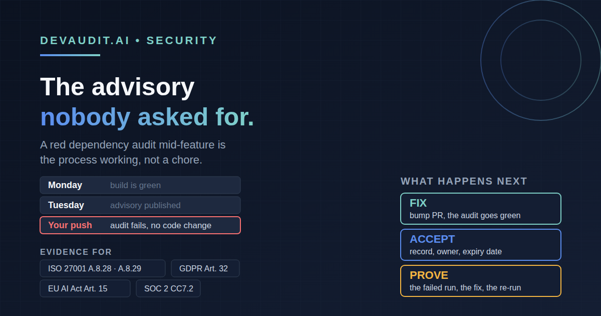

# The Advisory Nobody Asked For: Why a Failing Dependency Audit Mid-Feature Is the Process Working

> **Primary persona:** Lead Developer
> **Funnel stage:** MOFU — Consideration
> **Format:** Technical explainer (~1800 words)
> **Secondary persona callout:** CISO + Compliance Officer — see "What the auditor gets from an annoying afternoon"
> **Cross-links:** [/sdlc](https://devaudit.ai/sdlc) · [/compliance](https://devaudit.ai/compliance) · [docs/compliance-gates.md](https://github.com/metasession-dev/DevAudit-Installer/blob/main/docs/compliance-gates.md) · [docs/release-playbooks/](https://github.com/metasession-dev/DevAudit-Installer/tree/main/docs/release-playbooks) · [Six Kinds of Tests, One Safety Net](https://github.com/metasession-dev/DevAudit-Installer/blob/main/docs/articles/test-types-and-final-regression-long-form.md)

---

You are two-thirds of the way through a feature. The logic is done, the tests are green on your machine, and you push to open the pull request. CI comes back red. Not on your tests. On the dependency audit. You did not add a dependency. You did not change a lockfile. A package you have never heard of, three levels down, has a new advisory against it.

It is one of the most irritating build failures there is, because it feels like it has nothing to do with you. It is also, almost exactly, the moment a dependency process earns its keep. This article is about why that red build is a good thing, what DevAudit's process does next, and which compliance clauses that unwanted afternoon quietly satisfies.

## The red build you did not cause

An advisory database is not frozen. A vulnerability in a transitive dependency can be published at any time, which means a repository whose last build was green on Monday can fail an identical build on Tuesday with no change in code. DevAudit's own documentation says so plainly: the dependency audit "fails on any unaccepted `high`/`critical` advisory, including ones disclosed after the last push with no code change."

We hit exactly this while building the release-gate feature in our own portal. The feature pull request's Dependency Audit step failed on four advisories across two transitive packages, one of them rated high and three moderate. One was a web framework pulled in through a UI tooling dependency; the other was a build tool pulled in by the test runner. None of it was in code the pull request touched. The last build on the integration branch had been green; the advisories had been published since.

That is the annoying part, and it is real. Nobody planned for that interruption. But look at what the alternative would have been. Without a gate that evaluates the live advisory data on every change, those packages stay vulnerable until a quarterly review, or until someone else finds them first. The pull request that happened to trip the wire was not the cause. It was the first place anyone looked.

The fix is small: pin the patched versions through the package manager's overrides, in a dependency pull request of its own. With the overrides in place `npm audit` stops listing either package, so the detour costs one extra pull request and the feature pull request stays about the feature. That is the satisfying part, and it is not an accident of one afternoon. It is how the process is designed to feel.

## What the process does at that moment

The generated `Quality Gates` job runs `npm audit --json` and hands the result to a helper script, `evaluate-npm-audit.sh`. The helper does not trust npm's summary. It resolves npm's transitive graph to the concrete advisories, then evaluates every high and critical advisory independently against the installed lockfile path. Anything unaccepted fails the gate, and the failing run uploads a machine-readable record, `dependency-risk-evaluation.json`, in the CI results artifact.

That record is what turns "CI is red" into a short, well-defined task. For every unresolved advisory it lists the advisory ID, the severity, the package, the installed version, the full dependency path and what introduced it. Add `npm audit --json` for whether a fix is available and you have the whole decision on one screen. The agent driving the SDLC reads the same record: on a release pull request it lists the advisories for the operator and stops, reported as `[Blocked]`, instead of pressing on.

From there there are exactly two honest options.

**1. Fix it.** A dependency bump pull request, on its own branch from the integration branch, classified by the real semver bump. One practical rule from the implementer skill: land it first. A fix moves the head of any release pull request that sits on the integration branch and re-triggers its checks against the same audit, so merging compliance pull requests ahead of it just queues more red builds.

**2. Accept it, deliberately and temporarily.** Only when no compatible upstream fix exists. This is where DevAudit is deliberately unfriendly to shortcuts, and the next section is the reason why.

## Accepting a risk should be harder than fixing it

Every team has met the audit-ignore file full of advisory IDs that nobody has looked at since the person who added them left. DevAudit's exception mechanism is designed so that cannot happen quietly.

- **No package-name allowlists.** An exception names one exact advisory at one lockfile dependency path and installed version. A broad or partially matching entry fails closed, as does a missing reference or a cycle in the dependency graph.
- **A real record behind every entry.** A `schemaVersion` 2 entry must point at a risk-acceptance record. A validator script checks that record states the reachability and exploitability (and how that was checked), the impact assessment, the compensating controls, the decision-maker and a review date that is still in the future. It must list the same advisory and name the same tracking issue as the entry.
- **A tracking issue with a clock.** The issue carries the `accepted-dependency-risk` label and a `Review by` date. The exception entry itself has an `expiresAt`, and an expired entry fails the gate again. Extending it is a new risk decision with fresh evidence, not an administrative edit.
- **Something watches the clock.** `devaudit doctor` flags every accepted exception that has expired or expires within 14 days, so an acceptance cannot simply age out of everyone's attention.
- **It becomes evidence.** The raw audit output and `dependency-risk-evaluation.json` stay with the release, the evaluation records the acceptance record's path and SHA-256 hash, and the records upload as the `accepted_dependency_risk` evidence type. Nothing about the decision lives only in someone's memory.

The effect is that "we know about it and we are living with it for now" is a legitimate, recorded, expiring position, and "we silenced it" is not an available one.

## Where it sits in the lifecycle

The dependency check is not a single event. It is a layered habit, cheap early and thorough later:

| When | What runs | Why it matters |
| --- | --- | --- |
| While implementing | The agent runs all gates locally, including the dependency audit, before it opens the pull request | The annoying finding arrives while the change is still in your head |
| On the pull request and every push to the integration branch | `Quality Gates` runs the audit and the evaluation helper | A newly disclosed advisory is caught by the next change, not the next quarter |
| On the release pull request | A provenance check requires `Quality Gates` to have passed on that exact commit | A release cannot carry an unaccepted high or critical advisory by oversight: it is fixed, or accepted with a record |
| Quarterly | The dependency deep audit in the periodic security review | Catches what accumulates across changes, with its own evidence folder |

Notice that this matches how the work actually happens. Most of the value comes from the second row: the audit runs on every change, so whoever is closest to the code when an advisory lands is the person who sees it.

## It matters more when an AI writes the code

AI coding agents are very good at adding a dependency to solve a problem and very bad at asking whether it is current. The test policy that ships with the framework names the risk directly: fabricated, outdated or vulnerable packages. Its mandatory controls say AI-generated code must pass the same SAST and dependency scanning gates as human-authored code, and that those gates are "mandatory, not optional."

The gate does not care who wrote the `package.json` change. That is the point. A human reviewer skimming a pull request will not notice that a freshly added package pulls in an advisory three levels down. The audit will, every time, with the same bar for the agent and for the senior engineer.

## What the auditor gets from an annoying afternoon

For the CISO and compliance reader: the process above produces evidence that maps onto specific clauses. These are the mappings in the DevAudit portal's framework registry, not general aspirations:

| Framework | Clause | What the dependency evidence supports |
| --- | --- | --- |
| ISO/IEC 27001:2022 | A.8.28 Secure coding | Dependency audit results from the CI pipeline, alongside SAST and the security summary |
| ISO/IEC 27001:2022 | A.8.29 Security testing in development and acceptance | SAST and dependency audit results as security testing evidence per release |
| GDPR | Art. 32 Security of processing | SAST, dependency audit and security summary results as technical measures evidence |
| EU AI Act | Art. 15 Accuracy, robustness and cybersecurity | The same set, for teams building high-risk AI systems |
| SOC 2 | CC7.2 System monitoring and incident response | The per-gate pass/fail outcome manifest from the pipeline, which records the dependency audit result |
| SOC 2 | CC8.1 Change management | The four-eyes release approval, which a release carrying an accepted risk still has to pass |

This is the "one gate, several frameworks" idea in practice: a single audit run produces evidence that several frameworks' controls look for, with no separate documentation exercise.

Two honest caveats, because overclaiming helps nobody. DevAudit is not a certification, and it is not a vulnerability scanner: `npm audit` and your advisory sources do the scanning, and DevAudit makes the result a gate, records the decision and keeps the proof. Producing the evidence is our job. Deciding whether it satisfies a control is the auditor's.

What an auditor does get is a trail they can follow without asking anyone: the failing run, the evaluation record, the fix pull request or the acceptance record with its owner and expiry, the tracking issue, and the green re-run. For an accepted risk they get the reasoning and the date it will be revisited. That is a very different conversation from "can you show us how you manage vulnerable dependencies?"

## Why this is a good way to work

- **It finds the problem when you are already looking at the code.** An advisory caught on a feature branch costs a pull request. The same advisory found in a quarterly review, or an incident, costs far more.
- **The cost of acceptance is proportional to the risk.** Fixing is cheap and quick. Accepting needs reasoning, an owner and an expiry, so people fix when they can.
- **Nothing depends on remembering.** The gate runs, the record is written, the clock is watched. The process does not need a conscientious person to stay conscientious.
- **The evidence is a by-product.** Nobody writes an audit pack for dependencies. The failed run, the fix and the re-run are the pack.

That is the idea behind the whole framework: compliance as a byproduct, not a project. The next time a build goes red on a package you did not touch, it is worth a moment of gratitude. Something found it before an attacker did.

*DevAudit is in soft launch. The framework and CLI are open source; if you spot a gap in how any of this is documented, open an issue.*

**CTA:** See what the framework maps to → [devaudit.ai/compliance](https://devaudit.ai/compliance)
