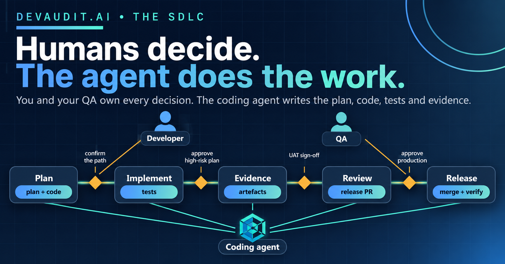

# Humans Decide, the Agent Does the Work: How DevAudit Splits an SDLC Between Developer, QA and a Coding Agent

> **Primary persona:** CTO + Lead Developer
> **Funnel stage:** MOFU — Consideration
> **Format:** Workflow explainer (~2200 words)
> **Secondary persona callout:** QA lead — see "Where QA sits"
> **Cross-links:** [/sdlc](https://devaudit.ai/sdlc) · [docs/credentials.md](https://github.com/metasession-dev/DevAudit-Installer/blob/main/docs/credentials.md) · [docs/change-workflows.md](https://github.com/metasession-dev/DevAudit-Installer/blob/main/docs/change-workflows.md) · [docs/skills.md](https://github.com/metasession-dev/DevAudit-Installer/blob/main/docs/skills.md) · [docs/release-playbooks/](https://github.com/metasession-dev/DevAudit-Installer/tree/main/docs/release-playbooks)

---

Handing a ticket to a coding agent is the easy part. The hard part is deciding what it may do on its own, and what it must wait for a person to do.

There are two common answers, and both go wrong. In the first, the agent does everything: it plans the work, writes the code, writes the tests, opens the pull request and, in some setups, merges and approves its own work. Nothing in that pipeline is a second pair of eyes, because there is only one actor. In the second, a person does everything and the agent is a faster keyboard, so the time you hoped to save goes into writing plans, filling in forms and keeping a tracker honest by hand.

DevAudit splits the work by kind, not by quantity. People decide, plan the scope, review and sign off. The agent writes the implementation plan, the code, the tests and the evidence, and carries the release as far as a person has said it may go. The boundary between the two is not a convention. It is built into which credentials each side holds. This article walks through where the lines fall, for a developer and for a QA reviewer.

## One prompt, five stages

The entry point is a single sentence to the agent: `Implement issue #N under the SDLC.` A skill called `sdlc-implementer` picks it up and drives the issue through the five stages of the framework. Here is who does what.

| Stage | The agent does | The people do | The agent stops when |
| --- | --- | --- | --- |
| **1. Plan** | Classifies the issue, announces what it is about to run, writes the implementation plan (acceptance criteria, risk class, threat model), and drafts the requirement, decision and risk records | Confirm the path; read the plan; approve it when the risk is HIGH or CRITICAL | A high-risk plan is waiting for approval, or the issue is too broad and needs splitting |
| **2. Implement** | Writes failing tests first, implements against the plan, runs the gates cheapest first, delegates E2E specs to the E2E specialist skill, commits and lands the work on the integration branch | Nothing, unless a gate keeps failing or the work grows beyond the plan | The scope expands, or three fix attempts have not turned a gate green |
| **3. Evidence** | Compiles the test scope, test plan, execution summary, requirement alignment and risk assessment, and commits them; CI uploads them to the portal | Nothing | A required artefact is missing |
| **4. Review** | Prepares the one truthful release pull request, classifies anything blocking it, and stops | Do UAT in the portal: submit for review, test, record the result, then approve or request changes | A person has not yet recorded a decision |
| **5. Release** | Reads the portal state, merges after approval, watches the deploy and the production smoke, opens the close-out | Approve Production and mark the release as released | Production has not been approved |

Two things stand out. The people appear at a handful of decision points, not throughout. And at each boundary the agent stops and says what is needed and who needs to do it.

## The first human moment: agreeing what is about to happen

Before any code, the agent triages the issue. It reads the labels, the title and the body and decides which of six change types it is: a tracked feature or fix, or one of several lighter paths for housekeeping, trivial changes and documentation. Then it posts a short "workflow decision": the change type, the risk class, which gates and evidence will run, what is skipped, and, in a line that matters to the reviewer, **which approvals the person will have to give**.

The pause is proportionate. A tracked change waits for a confirmation. An ambiguous one waits too. A trivial housekeeping change is announced and proceeds. Either way the person can reclassify at once ("treat this as housekeeping", "this is HIGH risk"), which is how a team stops every ticket defaulting to maximum ceremony.

Then the plan. For a tracked change the agent writes an implementation plan from the project's template, with acceptance criteria and a verification method for each, a risk classification with its reasons, and sections for the threat model, data flows and, where AI is involved, oversight. Along the way it calls three sibling skills: one that aligns each acceptance criterion with the project's requirements document, one that decides whether the change needs an architecture decision record, and one that drafts entries in the risk register. For MEDIUM and HIGH risk, the register entries land in the plan.

A person approves the plan before work continues when the risk is HIGH or CRITICAL. A team that wants that pause on every change can switch it on for all classes with a flag or an environment variable. And if the issue spans clearly separate deliverables, the agent does not press on: it halts and asks for it to be split. Later, if the work starts to grow past the plan, a scope-expansion gate stops it again. A ticket does not quietly get bigger.

## What the agent does with the time you did not spend

This is where the hours go. The agent writes failing tests first, with depth that scales with risk. It implements against the plan and records any deviation. It runs the local gates cheapest first, because lint takes seconds and a full browser suite takes far longer, and it iterates on the fast ones before spending the slow one. End-to-end specs go through a specialist skill rather than being written inline. Commits carry a requirement reference and a co-author trailer naming the AI, which is the audit trail's first link.

Then it compiles the evidence: the test scope and plan, the execution summary, the requirement alignment, the architecture decision and the risk assessment, committed under `compliance/evidence/REQ-XXX/`. The agent does not upload them. CI does, when the compliance commit lands.

Throughout, a sticky comment on the issue says what happened last and what comes next, including lines like "Operator action: open the release in the portal, record UAT, then ping resume". Anyone returning to the issue can tell in a glance whose turn it is.

## Where the agent stops, and why it cannot cross the line

You might expect that restraint to rely on the agent being well behaved. It does not. The credentials do the work.

An agent running this skill holds neither the project's uploader key nor the person's personal access token. The uploader key lives in CI, and CI does every portal write: it creates the release, uploads the evidence and reports the test runs. The personal access token belongs to the person. The agent reads portal state with the person's viewer key, which can read and cannot change anything.

The skill's own table makes the split plain:

| Step | Who does it |
| --- | --- |
| Create the release, upload evidence, report test runs | CI |
| Read portal state, check readiness | The agent, with a read-only key |
| Submit for UAT review, record UAT, approve or request changes | A person, in the portal, under their own login |
| Resolve a failed test execution | A project admin, in the portal |
| Approve Production, mark as Released | A person, in the portal |

There is no prompt that makes the agent approve its own release, because it holds nothing that can. The skill is also told, in as many words, never to run anything that records or submits UAT on a reviewer's behalf.

## Where QA sits

For a QA reviewer the framework is more than a gate at the end. QA owns what counts as tested, and the process is built to hand that decision to a person.

- **UAT is a record, not a click.** Submitting for review is only a queue transition; it is not evidence that UAT passed. The reviewer performs UAT and records the result under their own login before approving. A failed UAT goes back into the change-request loop with a remediation reference.
- **Who may approve is a setting, not a habit.** With `approval.mode: dual_actor`, the default, a different person must approve, and for HIGH and CRITICAL changes the agent halts if the reviewer is the person who started it. With `solo_with_gap`, one person may approve their own work, and the gap is recorded as a control-gap entry in the risk register instead of being hidden.
- **Coverage is stated honestly.** Before handing off, the agent reads the acceptance-criteria coverage from `devaudit doctor` and lists every criterion that is not backed by a test tagged to it. It offers three options (add or retitle a test, raise the release gate so a regression-only test is re-run, or mark the criterion not applicable with a reason) and leaves the choice to the person.
- **A red gate is a decision, never a default.** If a required check fails, the agent does not go on to UAT. It ends its turn blocked, lists each failed spec with its error and run link, and offers exactly two paths: fix it and re-run green, or accept it with a written exception and impact assessment. A project admin records the outcome in the portal.
- **Change requests are classified.** A reviewer's comment is sorted into a defect (an incident is filed, then fixed), a requirements gap (the person chooses whether to accept it, amend the criteria or open a follow-up) or a scope change (a separate issue). Five rounds without convergence and the agent stops and asks whether to abandon, split or restart from a fresh plan.

## After sign-off: the agent merges and watches

When the reviewer approves, the person tells the agent to resume. It reads the release state again, and if it is approved it merges the release pull request with a merge commit, which keeps the audit trail intact. The merge is already guarded: the release approval check on the pull request will not pass until the portal says UAT is approved.

What happens next depends on where you deploy. A host such as Vercel or Railway deploys from the merge. For a custom host, the generated workflow runs the project's own deploy command and records the deployment. Either way, the agent then does the checking a person would otherwise do by hand. It watches the post-deploy workflow until it reaches a terminal state, requires the host's deployment status for the merged commit to be a success (a passing health probe alone is not accepted as proof), and checks that production smoke evidence landed.

Note what DevAudit does not claim. UAT is a review of recorded evidence in the portal, not a deployment the agent performs. The agent's part in production is to merge only after the sign-off exists, and to verify what the host did.

By default it then stops again. The release waits at production review until a person approves Production and marks it released; a project that prefers can set the terminal status so the pipeline releases automatically. If production smoke fails, the agent does not mark anything released: it files an incident, and follows the rollback plan from the implementation plan. After release, a close-out pull request opens automatically to reconcile the requirements table and file the release ticket, and the agent reviews and merges it once its checks are green.

## Where the time goes

We have not put a percentage on this, and we would be wary of anyone who did. What can be said is where the effort moves.

The developer and QA stop writing plan documents, requirement rows, evidence folders, release pull request descriptions and tracker updates, and stop reconstructing the paper trail at the end. They keep the parts that need judgement: deciding the scope, reading a plan, performing UAT, choosing between fixing and accepting a failure, and approving production. Those are the decisions an auditor would want a named person to have made, and each is recorded in the portal under that person's login.

## Dial it to your team

The split is configuration, committed in `sdlc-config.json`, so a change shows up in a pull request diff rather than a settings screen. A few settings matter most here:

- `approval.mode`: `dual_actor` (a different person approves) or `solo_with_gap` (the author approves with a recorded gap).
- `release_gate_tier`: which test tier must pass on the release pull request.
- `production_review.terminal_status`: whether production needs a person's approval or releases automatically.
- `e2e_regression_enabled`: whether the regression workflow exists at all (the critical tier on the release pull request, the full regression after deploy).

Change one with `devaudit configure set <key> <value>`, and run `devaudit doctor` to see where the setup has drifted.

## What this is not

DevAudit makes sure that review happens, that the right person records it, and that the proof is kept. It cannot make the review good. It is not a certification: it produces the evidence, and an auditor decides what it means. And it does not replace engineering judgement. It moves the typing and the paperwork to the agent so the judgement is the part left for people.

That is the idea behind the whole framework: compliance as a byproduct, not a project. The plan, the tests, the evidence and the approvals are what the agent produces on the way to shipping the feature, and the audit trail is simply that work.

## Related

- [The Agentic SDLC: Why 2026 Is the Year Software Engineering Gets a New Operating Model](https://devaudit.ai/blog/agentic-sdlc)
- [Six Kinds of Tests, One Safety Net](https://devaudit.ai/blog/test-types-and-final-regression)
- [The Advisory Nobody Asked For](https://devaudit.ai/blog/dependency-advisory-mid-feature)

*DevAudit is in soft launch. The framework and CLI are open source; if you spot a gap in how any of this is documented, open an issue.*

**CTA:** See the full lifecycle → [devaudit.ai/sdlc](https://devaudit.ai/sdlc)
