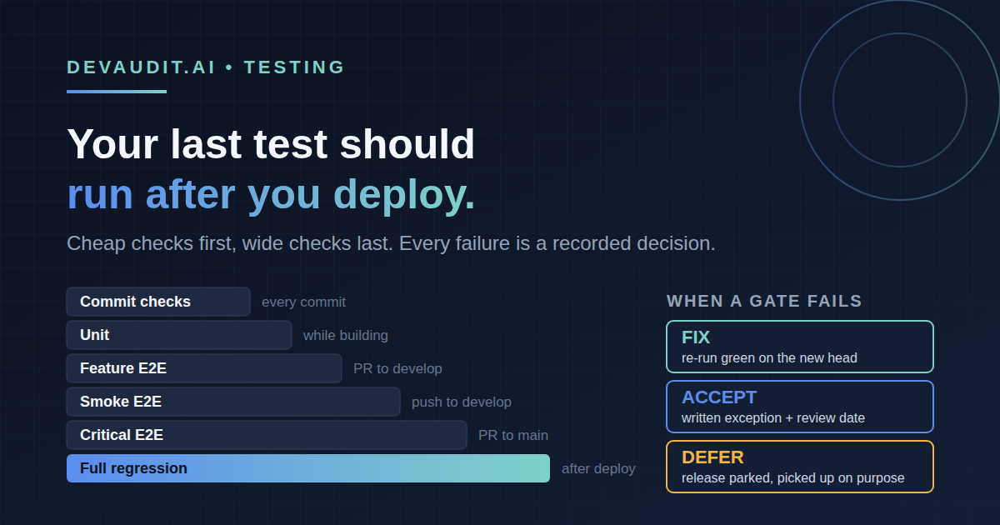

# Six Kinds of Tests, One Safety Net: What Runs When, and What Happens When the Last Gate Fails

> **Primary persona:** CTO + Lead Developer
> **Funnel stage:** MOFU — Consideration
> **Format:** Technical explainer (~1800 words)
> **Cross-links:** [/sdlc](https://devaudit.ai/sdlc) · [docs/e2e-test-tiers.md](https://github.com/metasession-dev/DevAudit-Installer/blob/main/docs/e2e-test-tiers.md) · [docs/compliance-gates.md](https://github.com/metasession-dev/DevAudit-Installer/blob/main/docs/compliance-gates.md) · [docs/release-playbooks/](https://github.com/metasession-dev/DevAudit-Installer/tree/main/docs/release-playbooks)

---

"We have tests" is not a testing strategy. Most teams have unit tests, a Playwright suite and a CI badge, and still cannot answer two questions on release day: which of these tests is allowed to stop a release, and what exactly happens when one of them fails?

This article walks through the layers DevAudit's SDLC uses, when each one runs, where the slowest one runs by default and how a project chooses a different gate, and how a failure becomes a recorded decision (fix it, accept it, or defer the release) instead of a quiet merge.

## The layers, from keystroke to production

Think of it as a funnel. Each layer is slower and wider than the one before, so the cheap layers catch most problems early and the expensive layers only run when the cheap ones are green.

| Layer | Runs | What it proves | Speed |
| --- | --- | --- | --- |
| **Commit-time checks** | On every commit and push, locally | Lint and format, a conventional commit with a `Ref: REQ-XXX` requirement, a clean TypeScript check | Seconds |
| **Unit tests** | While you implement (stage 2), owned by the project | Individual functions and components behave, with mocked data | Under 30 seconds |
| **Feature (in-scope) tests** | On pull requests into the integration branch | The tests tagged with the requirement you are changing pass | Minutes |
| **Smoke E2E** | On every push to the integration branch, inside the `Quality Gates` job | The app boots and the main happy path works | Minutes |
| **Release gate** | On the pull request into the release branch (opt-in): `critical` by default, or `smoke` or `full` if the project chooses | The tier you decided must pass before anything reaches production does pass | Critical 10-15 minutes; full up to about an hour |
| **Full regression** | After a successful production deployment by default (opt-in), and optionally on a schedule or as the release gate | Everything in the E2E suite still works, built from the exact commit that was deployed | Up to about an hour |

Two more checks sit around the funnel rather than inside it. The generated `Quality Gates` job also runs a TypeScript check, a SAST scan and a dependency audit before E2E, and a build after it. After deploy, `post-deploy-prod.yml` runs an independent health probe, confirms the host's deployment reached `success` for the merged commit, and runs a read-only production smoke.

The tiers are not different tools; they are the same tool pointed at progressively larger sets of tests. By default that tool is Playwright, with the tiers as named projects (`e2e/smoke/`, `e2e/critical/`, then everything). The tier names are not tied to it: a project can name a command for each tier, or set a pytest runner, and run API, integration and contract suites on Playwright, pytest, Jest or Vitest with the same smoke, critical and full names, the same requirement tags and the same portal checks. Unit tests are the exception. They are fast by definition, so the whole unit suite runs on every pull request and is not tiered. Because the tiers are only a selection, a team can opt into the bigger ones without rewriting anything.

## Why the full regression runs last by default

The obvious instinct is to run the whole suite on every pull request. On a real project that suite can take close to an hour and, as we wrote about in [the long-run flakiness piece](https://devaudit.ai/blog), a long single run is the place where infrastructure noise shows up. Gate every merge on it and you trade release safety for a slow, flaky queue.

The tiered model splits the job:

- **Before merge**, run the fast layers that are cheap enough to be strict: smoke on the integration branch, critical on the release pull request. These are the "must not break" journeys, kept small on purpose so a red result means something.
- **After deploy**, run the full regression on the exact commit that was deployed. It starts its own application server on the CI runner at that commit, so it is not a test of the live site; the read-only production smoke and the independent health probe are what touch production. It is deliberately the least time-pressured layer, so it is allowed to be wide. It is the safety net for whatever the critical tier let through, and it still runs against the precise commit that shipped.

The benefit is that velocity and coverage stop fighting. Developers get quick, trustworthy signal on every push, the release gets a focused gate, and the exhaustive check still happens, on the thing customers are actually using.

## Choosing the gate for your project

"After deploy" is a default, not a rule. It has a cost: a failure in the full pack surfaces once production is live, outside the fix, accept or defer rules that govern the release pull request. Whether that trade is right depends on your suite, so DevAudit makes it a per-project setting with three keys in `sdlc-config.json`:

| Setting | Values | If you set nothing |
| --- | --- | --- |
| `release_gate_tier` | `none`, `smoke`, `critical`, `full`: the tier that runs on the pull request into the release branch | `critical` |
| `post_deploy_full_regression` | whether the full regression also runs after a successful production deploy | on |
| `scheduled_full_regression` | a cron expression for a full run on the integration branch | off |

Three combinations cover most projects:

- **Strictest:** `full` before merge, post-deploy off. The release candidate is tested in full, the same commit is not tested twice, and the release waits for the slowest check. Right when failures after deploy are expensive.
- **Earlier signal:** keep `critical`, add a nightly full run, leave the post-deploy run on. Today's behaviour plus a warning that arrives before the release.
- **No E2E suite yet:** `smoke` or `none`, until there is something worth gating on.

Nothing is changed for you. A project that sets none of these keys gets exactly the workflows it had before, and an update never moves the gate. You set the choice when you install, or later with `devaudit configure set release_gate_tier full`, which validates the value and shows what will be regenerated.

`devaudit doctor` reviews the choice and proposes, but never applies. It reads the project without running a test and reports a gate that cannot take effect (the regression workflow is off), a `full` gate with no full tier to run, a full pack whose recent runs are longer than its job timeout, a post-deploy run that repeats a `full` gate, and a schedule that has not fired in a week. From your real run times it also suggests whether `full` before merge is affordable or whether `critical` plus a schedule fits better. A tier that selects no tests, or a missing smoke tier, is reported the same way. Changing a gate is a policy decision, so it goes through `devaudit configure` and a normal pull request.

When the gate is configured, the run records the tier it executed, the portal check is labelled for that tier (`E2E Smoke`, `E2E Critical` or `E2E Full (pre-merge)`), and the release gets a dedicated `E2E Release Gate` check with the tier and the commit it ran on, so the release shows which gate it passed.

One run is deliberately different. **A scheduled run is not release evidence.** It tests the integration branch, not a release candidate, so it is never uploaded to the portal and cannot attach to an in-flight release or block an approval. A failed nightly run opens one `bug` issue (and comments on it on later failures) so the early signal reaches someone.

## What does and does not block a release

This is the part that surprises people, so it is worth being precise.

- Only `Quality Gates` is a GitHub branch-protection required check. That is deliberate: a conditionally triggered check marked as required can leave a pull request permanently blocked, a lesson that cost three separate fixes before the current split.
- `E2E Regression Suite`, `Release Scope Integrity`, `Compliance Validation` and `DevAudit Release Approval` are a reviewer-verified checklist for the release pull request. The tier behind `E2E Regression Suite` is the one your project chose as its release gate.
- What actually stops a release with an unresolved E2E failure is the portal. A failed, timed-out or cancelled test execution with no recorded resolution raises an `execution_triage_missing` blocker, so the release cannot be approved. The agent driving the SDLC also stops and reports the release as blocked.

One more detail that is easy to misread. When the full regression fails after deploy, the workflow files a `bug, priority:high` issue naming the merge commit and the failing specs. That issue is a prompt to triage, not an acceptance. Nothing at any tier is accepted automatically, and nothing is reverted automatically either. If you move the full pack in front of the merge, the same failure instead lands on the release pull request, where the three outcomes below apply directly.

## When a gate fails: fix, accept, or defer

A failing required gate on the release pull request, whichever tier it is, ends in exactly one of three recorded outcomes. There is no silent fourth path, and "known unrelated flake" is not a disposition.

First, classify the failure: a flake, a test bug, an application defect or a seed-data gap. Then choose.

**1. Fix it in this release.** Open an issue, branch `fix/<issue#>-<slug>` from the integration branch, merge the fix, and wait for a green re-run on the new head commit of the release pull request. Record the verified re-run in the portal as `retry_passed`, referencing the passing run. A run that was merely cancelled is superseded automatically once a later run in the same stage passes.

**2. Accept it, with a documented exception.** This is never automatic. The record names the failing specs and the CI run, includes an impact assessment (affected journeys and requirements, data and compliance exposure, likelihood and severity, compensating controls), the decision-maker, the date and a review date, and links a tracking issue labelled `accepted-e2e-failure`. It is validated by script, then recorded in the portal as `accepted_exception` with the tracking issue as the remediation reference. The record is uploaded as evidence, and `devaudit doctor` later flags any accepted exception that has passed its review date.

**3. Defer the release.** If the work should not ship now, the release pull request is closed unmerged and the ticket declares `Release intent: deferred-to-next` with a reason. The requirement is marked `DEFERRED`, which is non-terminal: a promotion gate fails any later release that contains the deferred requirement's commits unless that release explicitly lists it as an absorbed predecessor. Deferral cannot be forgotten; it has to be picked up on purpose.

Whichever you choose, the test summary has to agree. `test-execution-summary.md` is regenerated with the CI stamp, every attempt (including the failed first one) and a triage table, and a validator refuses a summary that reads PASS while a failure is unresolved.

## Why this is a good way to work

- **Fast feedback where it is cheap, depth where it is safe.** The layers match the cost of the failure to the cost of the check.
- **The decision is always human and always recorded.** A failure becomes a fix, a signed-off exception with a review date, or a tracked deferral. An auditor can see which one, who decided and why.
- **The process cannot be skipped by habit.** The portal blocks approval, the agent stops, the summary validator rejects a dishonest report, and `doctor` surfaces exceptions that have gone stale.
- **The evidence is a by-product.** Nobody writes a separate audit pack. The failed run, the triage, the exception record and the re-run are the pack.

That is the same idea behind the whole framework: compliance as a byproduct, not a project. Testing discipline that is enforced by the workflow is also the evidence that you followed it.

*DevAudit is in soft launch. The framework and CLI are open source; if you spot a gap in how any of this is documented, open an issue.*

**CTA:** See the E2E tier model → [docs/e2e-test-tiers.md](https://github.com/metasession-dev/DevAudit-Installer/blob/main/docs/e2e-test-tiers.md)
